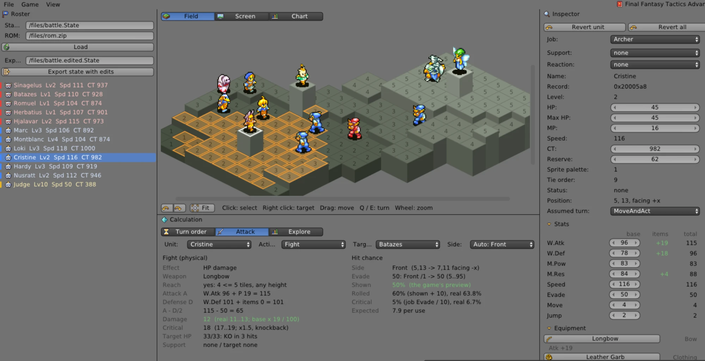
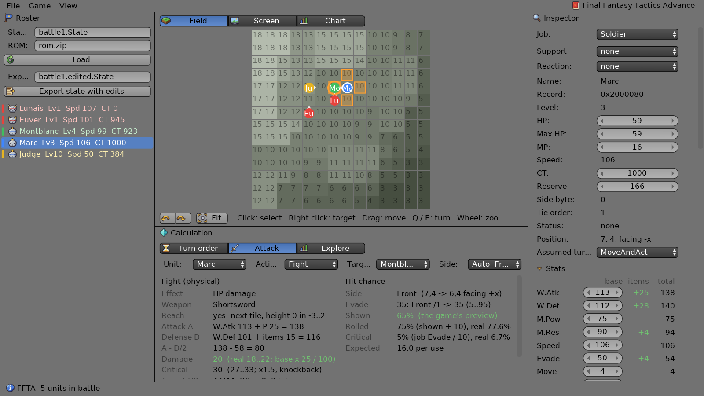
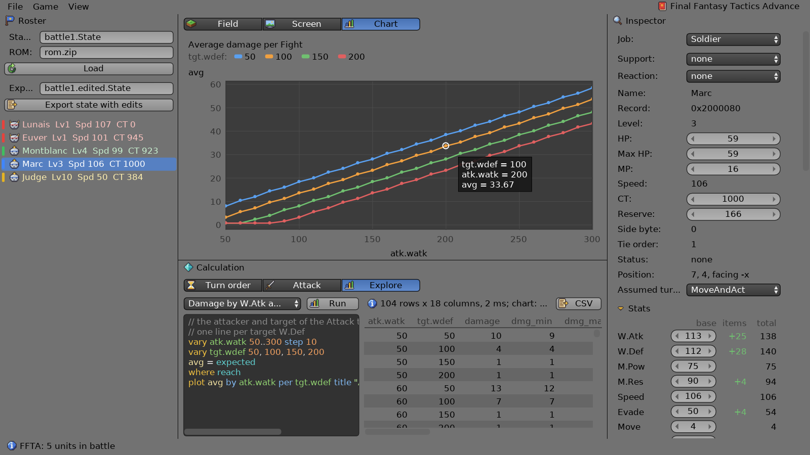

# DasBattleCalc

**Try it in the browser: https://spiiin.github.io/DasBattleCalc/** (you load your own save and ROM; the files stay in
the browser).

A battle calculator for **Final Fantasy Tactics Advance** (GBA, USA). It reads a BizHawk save state from the
middle of a battle and shows what the game is about to do: turn order, damage, hit and critical chances, abilities and
reactions. The formulas were taken from the ROM and checked against the game itself. You can edit units and write the
changes back into a new save, or run parameter experiments and plot the results.

Written in [daslang](https://github.com/GaijinEntertainment/daScript) with [dasSDL3](https://github.com/spiiin/dasSDL3)
and Dear ImGui (Blender 2.7-style widgets). Runs on the desktop (Windows) and in the browser (standalone AOT, WebAssembly).



## What it does

- **Battle from a save**: units, their stats and equipment as on the game's Status screen, the map with heights.
- **Turn order**: the next N turns, computed with the game's CT tick model.
- **Attack calculator**: the game's damage forecast and its spread, the shown hit chance and the real one (the game's
  RNG makes them differ), criticals, the reach of the weapon on the map. It covers abilities of all jobs: damage,
  healing, MP damage, drain, statuses and area effects. It also shows the target's reaction (Counter, Strikeback,
  Reflex, …) and the counter-attack.
- **Editor**: change stats, equipment, job, statuses, support / reaction and learned abilities, or drag units on the
  field. Everything is recalculated immediately. **Export state with edits** writes a new BizHawk save that you can load
  in the emulator.
- **Game graphics** (on by default, View menu): the units' map sprites and the item icons, decoded from your ROM.
- **Explore**: a short query language for parameter studies. Results go into a sortable table, a chart (lines, bars,
  points, log scales) and CSV export.
- **Final Fantasy Tactics A2** (NDS, USA; Game menu), early stage: the units of a battle from a BizHawk melonDS save
  (names, jobs, races, HP / MP, CT, position, team), their stats as on the Unit Info screen, equipment, the battle map
  with its heights, the reach of the chosen action (range only) and the turn order (the game's CT rules, checked against 17 turns). The forecast of Attack and abilities (physical and magick damage, healing; sides,
  elements, statuses, support abilities) comes from the game's own formula scripts, run from your ROM by a small
  interpreter of its script VM (245 abilities checked against the game), with a step-by-step explanation; also the
  real hit chance, criticals and damage spread, and the next attack's outcome from the save's random generators
  (200 real attacks predicted exactly). Explore works for FFTA2 too (its own parameters: `atk.attack`,
  `tgt.status.protect`, `action`, `privilege`, ...). See [research/ffta2/notes.md](research/ffta2/notes.md).



```
vary atk.watk 50..300 step 10        // the attacker's base W.Atk
vary tgt.wdef 50, 100, 150, 200      // one line per target W.Def
avg = expected                       // average damage per attack
where reach
plot avg by atk.watk per tgt.wdef title "Average damage per Fight"
```



## Checked against the game

The model is compared with the game's own numbers in BizHawk. The Lua probes in [research/](research/) read the
forecast values straight from the game's functions. Tests:

| | |
|---|---|
| Turn order | 22 turns recorded in game; CT of all 12 units from the start of a second battle |
| Stats | the Status screens of 17 units, monsters and the Judge included |
| Attacks | 88 Fight forecasts (damage and shown hit) over two battles: front / side / back, elements, supports |
| Reach | the game's targetable tiles for sword, spear, bow and gun |
| Abilities, magic | 18 forecasts and real uses (Battle Tech, Fire, Thunder, Cure, Protect, …) |
| Reactions | Reflex, Strikeback, Counter, Bonecrusher on real hits |
| Real hit / critical | thousands of rolls with random seeds; the RNG correlation explains the difference |

The formulas, RAM layout and ROM tables are documented in [research/notes.md](research/notes.md).

## Build and run

Requirements:
- a Release build of dasSDL3 with ImGui (`DASSDL3_WITH_IMGUI=ON`);
- daScript master with one parser fix that is not merged yet: hex values in annotations, `@offset = 0xD0`;
- VS 2022 and Ninja.

```bat
set DASSDL3_DIR=C:/path/to/dasSDL3
build.bat
build\bin\battlecalc.exe --state <save>.State --rom <FFTA (USA)>.zip
```

The save is a BizHawk 2.x quick save made with the mGBA core, taken during a battle (FFTA2: the melonDS core,
`--game ffta2`). The web version is built with
`web\build.ps1` (Emscripten) into `build-web/site`. In the browser you pick the save and the ROM yourself, and the files
stay in the browser. The web build needs daScript's dasPEG module without `options no_aot`.

Tests: `build\bin\battlecalc.exe tests\test_ffta_*.das --state <save> --rom <rom>`; see [docs/usage.ru.md](docs/usage.ru.md).

## More

- [docs/usage.ru.md](docs/usage.ru.md): the full description in Russian (every panel, the Explore language, options,
  the web build, the code layout).
- [research/notes.md](research/notes.md): how the game works (turn order, damage, abilities, reactions, RNG, the save
  format).

## License

The code is under the [MIT License](LICENSE). Final Fantasy Tactics Advance and its names belong to Square Enix;
the game data tables in `research/` are notes for study, not covered by this license.

## Notes

This is an unofficial fan project. It is not affiliated with or endorsed by Square Enix. No ROM or save files are
included; you need your own copy of the game.

Third-party files: DejaVu Sans (DejaVu fonts license), miniz (public domain / Unlicense), zstd decoder (BSD),
stb_truetype (public domain / MIT). The icons are drawn for this project (`assets/icons/make_icons.py`).
