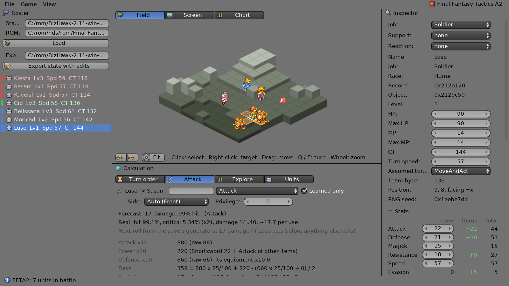
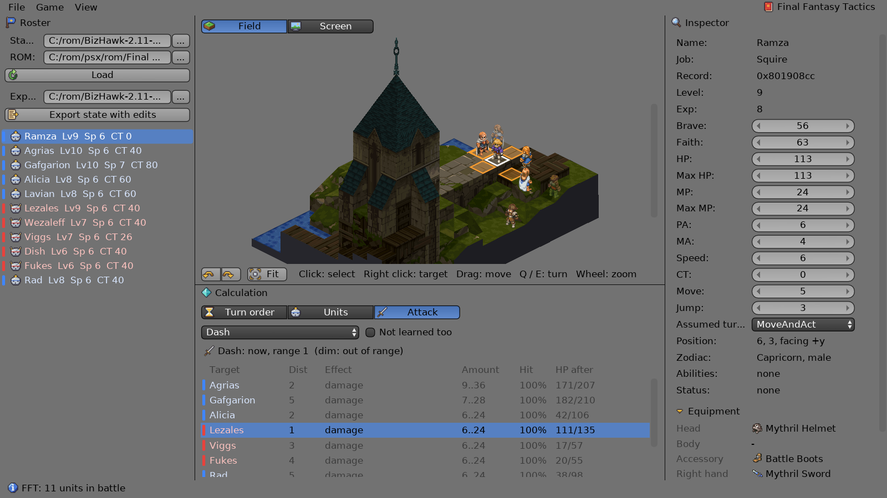

# DasBattleCalc

**Try it in the browser: https://spiiin.github.io/DasBattleCalc/** (you load your own save and ROM; the files stay in
the browser).

A battle calculator for **Final Fantasy Tactics Advance** (GBA, USA), **Final Fantasy Tactics A2: Grimoire of the
Rift** (NDS, USA), **Final Fantasy Tactics** (PSX, USA) and **Final Fantasy Tactics: The War of the Lions** (PSP, USA). It reads a BizHawk save state from the middle of a battle and shows what the game is about to do:
turn order, damage, hit and critical chances, abilities and reactions. The formulas were taken from the ROM and
checked against the game itself. You can edit units and write the changes back into a new save, or run parameter
experiments and plot the results.

Written in [daslang](https://github.com/GaijinEntertainment/daScript) with [dasSDL3](https://github.com/spiiin/dasSDL3)
and Dear ImGui (Blender 2.7-style widgets). Runs on the desktop (Windows) and in the browser (standalone AOT, WebAssembly).


## What it does (Final Fantasy Tactics Advance)

- **Battle from a save**: units, their stats and equipment as on the game's Status screen, the map with heights.
- **Turn order**: the next N turns, computed with the game's CT tick model.
- **Attack calculator**: the game's damage forecast and its spread, the shown hit chance and the real one (the game's
  RNG makes them differ), criticals, the reach of the weapon on the map. It covers abilities of all jobs: damage,
  healing, MP damage, drain, statuses and area effects. It also shows the target's reaction (Counter, Strikeback,
  Reflex, …) and the counter-attack.
- **Editor**: change stats, equipment, job, statuses, support / reaction and learned abilities, or drag units on the
  field. Everything is recalculated immediately. **Export state with edits** writes a new BizHawk save that you can load
  in the emulator.
- **Game graphics** (on by default, View menu): the units' map sprites and the item icons, decoded from your ROM.
- **Explore**: a short query language for parameter studies. Results go into a sortable table, a chart (lines, bars,
  points, log scales) and CSV export.


```
vary atk.watk 50..300 step 10        // the attacker's base W.Atk
vary tgt.wdef 50, 100, 150, 200      // one line per target W.Def
avg = expected                       // average damage per attack
where reach
plot avg by atk.watk per tgt.wdef title "Average damage per Fight"
```


## Final Fantasy Tactics A2

Choose it in the **Game** menu (or `--game ffta2`); the save is a BizHawk quick save made with the melonDS core.



- **Battle from a save**: the units (names, jobs, races, HP / MP, CT, positions, teams), their stats as on the Unit
  Info screen, the equipment, the battle map with its heights; the units' sprites and item icons from the ROM.
- **Turn order**: the next N turns by the game's CT rules (17 recorded turns match).
- **Attack calculator**: the forecast of Attack and of the abilities (physical and magick damage, healing; sides,
  elements, statuses, support abilities) comes from the game's own formula scripts: a small interpreter of its script
  VM runs them from your ROM (245 abilities match the game), with a step-by-step explanation. Also the real hit
  chance, criticals and damage spread, and the next attack's outcome from the save's random generators (200 real
  attacks predicted exactly). Status abilities show their chance to land (70 forecasts match).
- **Reach** as the game's own reach builder computes it: weapon types, height limits, the tiles that can be targeted
  (91 highlight lists match).
- **The target's reaction** (Counter, Strike Back, Reflex, Evade Magick, ...): whether it triggers by the game's rule,
  and the counter-attack's damage.
- **Editor**: job, base stats, support and reaction, HP / MP / CT, equipment (a list of what the job can wear), statuses
  and learned abilities by job; drag units on the field. The Attack tab lists the abilities the unit knows (or all).
  **Export state with edits** writes a new melonDS save; the game computes with the edits at once.
- **Explore** with its own parameters (`atk.attack`, `tgt.status.protect`, `action`, `privilege`, ...).

Not yet: area effects, effects other than damage, healing and statuses (Rend, steals, ...), the big monsters' sprites.
The formulas, RAM layout and ROM files: [research/ffta2/notes.md](research/ffta2/notes.md).

## Final Fantasy Tactics: The War of the Lions

Choose it in the **Game** menu (or `--game fftwotl`); the save is a PPSSPP save state (`.ppst`, PSP, USA, ULUS10297).
No ISO is needed: the game's tables and texts are read from the RAM in the state. The ISO (optional, in the ROM
field) gives the graphics: the units' sprites, the items' icons and the battle map's textured mesh.

- **Battle from a save**: the units (names, jobs, levels, Brave / Faith, HP / MP, CT, zodiac, positions, teams and
  guests), their stats, evades, elements, equipment and statuses; whose turn it is.
- **Turn order** by clock ticks (Speed, Haste / Slow / Stop, the CT a turn costs).
- **Attack calculator**: Attack with every weapon type, Holy Sword / Fell Sword, magicks (damage, healing, chances of
  status spells with Faith), Arts of War, Aim, Items, Fundaments; zodiac compatibility, Protect / Shell and the support
  abilities, elements, evasion by side. The formulas come from the PSX battle code
  ([research/fftwotl/formulas.md](research/fftwotl/formulas.md)); **291 forecasts of the game match (2 battles)** (the damage and hit % the game shows when a target is picked): Attack (every
  weapon kind, zodiac, statuses, evades, sides, elements, supports and reactions), Fire, Cure, Arts of War, Umbra,
  Potion, Rush, Stone, status magicks (Poison, Stop, Protect, Haste, Quick), Gravity, Empowerment / Invigoration,
  Rend Helm, Aurablast, Throw (every kind of thrown item, from the party's stock) and Jump; Shirahadori and Archer's
  Bane in the hit chance, a real Counter.
- **Arithmeticks**: the algorithm (CT, Level, EXP, Height), the number and the magick - which units are hit (allies and
  the caster too) and what it does to each; checked against the game on 2 battles.
- **The target's reaction**: which reaction it has (the record's ability bits), whether this action calls it (checked
  in the game with the action performed: 21 reactions), the Brave roll, the counter-attack's damage.
- **Editor**: job, primary / secondary skillsets, reaction / support / movement, PA / MA / Speed, Level, Exp, Brave,
  Faith, HP / MP / CT, the seven equipment slots (what the job can wear), statuses, learned abilities by job; drag units
  on the field. **Export state with edits** writes a new `.ppst` (PPSSPP: File > Load State).
- **Items / Abilities** tabs: the game's item and ability tables.
- **Explore** with its own parameters (`atk.pa`, `atk.brave`, `tgt.faith`, `tgt.status.protect`, `atk.zodiac`, ...).

- **The battle map** with its heights and water; with the ISO, the map's 3D model and the units' sprites.
- **Reach with the heights**: the tiles Attack reaches for each weapon kind (melee 3 h, polearms in a line, shooting
  weapons from 3 tiles, bows farther from above) and every ability (the own tile, the vertical tolerance, Throw =
  Move, Jump's reach) - the game's highlighted tiles match on 2 battles.

Not yet: whether a magick cast the usual way (it charges) calls the magick reactions. RAM layout and tables:
[research/fftwotl/notes.md](research/fftwotl/notes.md), [layouts.md](research/fftwotl/layouts.md).

## Final Fantasy Tactics (PSX)

Choose it in the **Game** menu (or `--game fft`); the save is a BizHawk save state made with the Nymashock core
(SCUS-94221). The units, the terrain and the game's tables are read from the RAM in the state; the disc (`.cue` or
`.bin` in the ROM field) is optional and only gives the graphics.



- **Battle from a save**: the units (names, jobs, levels, Brave / Faith, HP / MP, PA / MA / Speed, CT, Move / Jump,
  zodiac, equipment with icons, statuses, the active reactions / supports / movement abilities), the battle map with
  its heights; with the disc, the map's own textured mesh and the units' sprites.
- **Turn order** by clock ticks: Speed, Haste / Slow, Stop, the CT a turn costs, dead units, and charged abilities
  going off (a spell set with CT 4 goes off at the start of the 4th tick, before the turns).
- **Reach**: Move (Jump up and down, enemies block the way) and Attack by the weapon's kind - striking, spears in
  lines, bows with the height bonus, guns and crossbows - as the game marks the tiles (12 saves with the game's marks
  match).
- **Attack calculator**: Attack with every weapon kind, the zodiac, supports (Attack UP, Defense UP, Martial Arts,
  Concentrate), statuses (Protect, Berserk, Sleep, Charging, Chicken, Frog, Darkness, Defending), evades by side as
  the game takes them; the abilities the unit knows (or all): Guts, Battle Skill breaks, Black / White / Time Magic,
  Holy Sword, Dark Sword, Punch Art, Charge, Items, Throw and Jump, Math Skill (who its condition and number hit); elements (absorb, cancel, half, weak,
  strengthen) and the target's reaction. **65 forecasts of the game match**, in two battles.
- **Editor**: Brave, Faith, HP / MP, PA / MA / Speed, CT, Move / Jump, the job, the skillsets, reaction / support /
  movement, the equipment (an item picker by slot and job) and statuses; the stats, elements and ability bits the
  game keeps follow; a new job moves PA / MA / Speed and max HP / MP by its multipliers on the unit's raw stats.
  **Export state with edits** writes a new BizHawk state, a unit moved on the field included (its sprite follows).
- **Explore** with its own parameters (`atk.pa`, `atk.brave`, `atk.weapon`, `atk.support`, `tgt.zodiac`,
  `tgt.status.protect`, `action`, `side`, ...); the experiments give the game's forecasts (sides, zodiac, weapons,
  Attack UP, Protect, Fire).

The critical hit: 3000 attacks in the game give its most (2 XA - 1) x YA and 3.5-4% of the hits (5% in the model;
research/fft/notes.md). The prologue battle shows 0% for Frog and Death on everyone (elsewhere the model's numbers) - its flag is
not found. RAM layout, tables and formulas: [research/fft/notes.md](research/fft/notes.md).

## Checked against the game

The model is compared with the game's own numbers in BizHawk. The Lua probes in [research/](research/) read the
forecast values straight from the game's functions. Tests (FFTA; the FFTA2 checks are listed above):

| | |
|---|---|
| Turn order | 22 turns recorded in game; CT of all 12 units from the start of a second battle |
| Stats | the Status screens of 17 units, monsters and the Judge included |
| Attacks | 88 Fight forecasts (damage and shown hit) over two battles: front / side / back, elements, supports |
| Reach | the game's targetable tiles for sword, spear, bow and gun |
| Abilities, magic | 18 forecasts and real uses (Battle Tech, Fire, Thunder, Cure, Protect, …) |
| Reactions | Reflex, Strikeback, Counter, Bonecrusher on real hits |
| Real hit / critical | thousands of rolls with random seeds; the RNG correlation explains the difference |

The formulas, RAM layout and ROM tables are documented in [research/notes.md](research/notes.md).

## Build and run

Requirements:
- a Release build of dasSDL3 with ImGui (`DASSDL3_WITH_IMGUI=ON`);
- daScript master with one parser fix that is not merged yet: hex values in annotations, `@offset = 0xD0`;
- VS 2022 and Ninja.

```bat
set DASSDL3_DIR=C:/path/to/dasSDL3
build.bat
build\bin\battlecalc.exe --state <save>.State --rom <FFTA (USA)>.zip
```

The save is a BizHawk 2.x quick save made with the mGBA core, taken during a battle (FFTA2: the melonDS core,
`--game ffta2`). On the desktop the paths can also be picked with the **...** buttons next to the State / ROM / Export
fields, or by dropping a save (`.State`, `.ppst`) or a ROM / disc (`.gba`, `.nds`, `.zip`, `.cue`, `.bin`, `.iso`) on the
window; the last loaded paths are remembered. The web version is built with
`web\build.ps1` (Emscripten) into `build-web/site`. In the browser you pick the save and the ROM yourself, and the files
stay in the browser. The web build needs daScript's dasPEG module without `options no_aot`.

Tests: `build\bin\battlecalc.exe tests\test_ffta_*.das --state <save> --rom <rom>`; see [docs/usage.ru.md](docs/usage.ru.md).

## More

- [docs/usage.ru.md](docs/usage.ru.md): the full description in Russian (every panel, the Explore language, options,
  the web build, the code layout).
- [research/notes.md](research/notes.md): how the game works (turn order, damage, abilities, reactions, RNG, the save
  format).

## License

The code is under the [MIT License](LICENSE). Final Fantasy Tactics Advance and its names belong to Square Enix;
the game data tables in `research/` are notes for study, not covered by this license.

## Notes

This is an unofficial fan project. It is not affiliated with or endorsed by Square Enix. No ROM or save files are
included; you need your own copy of the game.

Third-party files: DejaVu Sans (DejaVu fonts license), miniz (public domain / Unlicense), zstd decoder (BSD),
stb_truetype (public domain / MIT). The icons are drawn for this project (`assets/icons/make_icons.py`).
